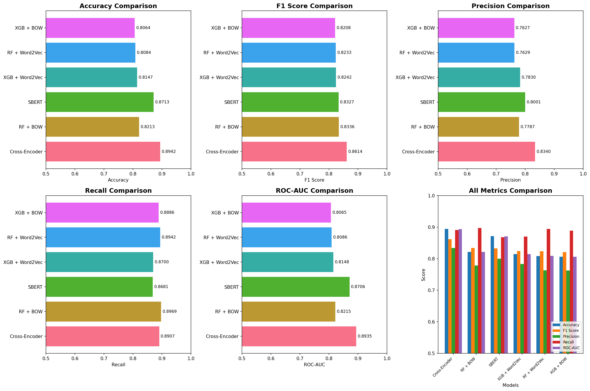

# SemSim — Quora Question Similarity

> **A production-style NLP system for detecting duplicate questions, comparing multiple machine-learning approaches, and retrieving answers from an FAQ knowledge base.**

[](https://www.python.org/)
[](https://fastapi.tiangolo.com/)
[](https://streamlit.io/)
[](#license)

SemSim combines traditional feature engineering, sparse text features, static word embeddings, sentence embeddings, and a cross-encoder into one interactive application. The best-performing model in the evaluated comparison is the **Cross-Encoder**, while the application also exposes an SBERT + FAISS FAQ search pipeline for practical question answering.

---

## Contents

- [What this project does](#what-this-project-does)
- [Highlights](#highlights)
- [System architecture](#system-architecture)
- [Model comparison](#model-comparison)
- [Repository layout](#repository-layout)
- [Installation](#installation)
- [Running the application](#running-the-application)
- [Using the API](#using-the-api)
- [Using the Streamlit dashboard](#using-the-streamlit-dashboard)
- [Machine-learning pipeline](#machine-learning-pipeline)
- [Data and artifacts](#data-and-artifacts)
- [Reproducibility notes](#reproducibility-notes)
- [Limitations and future improvements](#limitations-and-future-improvements)
- [License](#license)

## What this project does

Given two questions, SemSim estimates whether they express the same intent:

```text
Question 1: How can I learn Python?
Question 2: What is the best way to start learning Python?

Result: likely duplicate
```

The project has two complementary workflows:

1. **Question-pair similarity** — runs six trained approaches and returns a prediction, confidence, and model status for each approach.
2. **FAQ retrieval** — embeds a user query, searches a FAISS index, reranks candidates with a cross-encoder, and returns the most relevant FAQ answers.

## Highlights

- Six model families evaluated on the same duplicate-question task.
- Consistent text preprocessing shared by training and inference.
- Handcrafted lexical, overlap, length, substring, and fuzzy-matching features.
- CountVectorizer / Bag-of-Words models.
- Mean-pooled Google News Word2Vec sentence representations.
- Fine-tuned SBERT bi-encoder similarity scoring.
- Cross-encoder pair classification for the strongest measured result.
- FastAPI backend with health, prediction, FAQ, and metrics endpoints.
- Streamlit frontend with Home, FAQ Checker, Similarity Checker, and Analysis pages.
- FAISS-powered FAQ retrieval with optional cross-encoder reranking.
- Saved model and vectorization artifacts so the application can start without retraining.

## System architecture

```text
                         +----------------------+
                         |   Streamlit UI       |
                         | Home / FAQ / Models  |
                         +----------+-----------+
                                    |
                                    | HTTP
                                    v
+-------------------+      +-------+--------+       +----------------------+
| Question pair     | ---> |   FastAPI API   | ---> | Saved ML artifacts    |
| or FAQ query      |      |   :8000         |      | Joblib / SBERT / W2V |
+-------------------+      +---+---------+---+       +----------------------+
                                |         |
                                |         +--> Six similarity models
                                |
                                +------------> SBERT -> FAISS -> Cross-Encoder
```

For a similarity request, the backend normalizes both questions, computes the required feature representation, and evaluates the available models. For an FAQ request, the backend searches the prebuilt FAISS index and reranks the candidate results before returning answers.

## Model comparison

The following results are recorded in [`model_comparison_results.csv`](./model_comparison_results.csv). Metrics are reported on the project's held-out evaluation data.

| Rank | Model | Accuracy | F1 score | Precision | Recall | ROC-AUC |
|:---:|---|---:|---:|---:|---:|---:|
| 1 | Cross-Encoder | **0.8958** | **0.8632** | 0.8372 | **0.8909** | **0.8948** |
| 2 | RF + BOW | 0.8213 | 0.8336 | 0.7787 | 0.8969 | 0.8215 |
| 3 | SBERT | 0.8713 | 0.8327 | 0.8001 | 0.8681 | 0.8706 |
| 4 | XGBoost + Word2Vec | 0.8147 | 0.8242 | 0.7830 | 0.8700 | 0.8148 |
| 5 | Random Forest + Word2Vec | 0.8084 | 0.8233 | 0.7629 | 0.8942 | 0.8086 |
| 6 | XGBoost + BOW | 0.8076 | 0.8216 | 0.7650 | 0.8872 | 0.8078 |

**Interpretation:** the cross-encoder performs best overall because it models the interaction between both questions directly. The BOW and Word2Vec pipelines are useful baselines, while SBERT provides an efficient embedding-based approach suitable for retrieval and semantic search.



## Repository layout

```text
.
├── api.py                              # FastAPI backend and inference routes
├── streamlit_app.py                    # Streamlit dashboard
├── final_trying_2.ipynb                # Main experimentation notebook
├── final_trying.ipynb                  # Earlier notebook iteration
├── dataset.ipynb                       # Dataset exploration/preparation notebook
├── paperwork.ipynb                     # Project analysis/documentation notebook
├── requirements.txt                    # Pinned Python dependencies
├── train.csv                           # Quora question-pair training data
├── dataset/                            # FAQ source data
├── sbert_quora_model/                  # Saved SBERT model
├── cross_encoder_quora/                # Saved cross-encoder model
├── faq_faiss.index                     # FAISS FAQ vector index
├── faq_embeddings.npy                  # FAQ embedding matrix
├── faq_metadata.joblib                 # FAQ questions and answers
├── word2vec_trimmed.kv                  # Trimmed Word2Vec vectors
├── *_BOW.joblib                        # BOW-based classifiers/vectorizer
├── *_WTV.joblib                        # Word2Vec-based classifiers
├── sbert_results.joblib                # SBERT threshold/evaluation results
├── cross_encoder_results.joblib        # Cross-encoder threshold/results
├── model_comparison_results.csv        # Evaluation summary
├── model_comparison_metrics.png        # Metrics visualization
└── confusion_matrices_all_models.png   # Confusion-matrix visualization
```

The generated model directories and binary artifacts can be large. Keep them in Git only if your repository and Git hosting strategy are configured for large files; otherwise use Git LFS or an external model registry.

## Installation

### 1. Create and activate a virtual environment

Windows PowerShell:

```powershell
python -m venv .venv
.\.venv\Scripts\Activate.ps1
```

macOS/Linux:

```bash
python -m venv .venv
source .venv/bin/activate
```

### 2. Install dependencies

```bash
python -m pip install --upgrade pip
pip install -r requirements.txt
```

The pinned dependency list includes FastAPI, Streamlit, scikit-learn, XGBoost, NLTK, Gensim, Sentence Transformers, FAISS, Plotly, and the supporting numerical/NLP packages.

### 3. Check required artifacts

The application expects the saved models and retrieval assets to be available beside `api.py`, including:

- `count_vectorizer1.joblib`
- `randomForest_BOW.joblib`
- `XGBClassifier_BOW.joblib`
- `RandomForestClassifier_WTV.joblib`
- `XGBClassifier_WTV.joblib`
- `sbert_quora_model/`
- `cross_encoder_quora/`
- `sbert_results.joblib`
- `cross_encoder_results.joblib`
- `word2vec_trimmed.kv`
- `faq_faiss.index`
- `faq_metadata.joblib`

## Running the application

Start the backend first:

```powershell
uvicorn api:app --reload --port 8000
```

The API will be available at:

- Interactive Swagger documentation: <http://localhost:8000/docs>
- ReDoc documentation: <http://localhost:8000/redoc>
- Health check: <http://localhost:8000/health>

In a second terminal, activate the same environment and start Streamlit:

```powershell
python -m streamlit run streamlit_app.py --server.port 8501
```

Open <http://localhost:8501> in a browser.

If the backend runs on another host or port, set `API_BASE` before starting Streamlit:

```powershell
$env:API_BASE = "http://localhost:8000"
python -m streamlit run streamlit_app.py --server.port 8501
```

## Using the API

### Health and model status

```bash
curl http://localhost:8000/health
```

The response reports whether the saved models and FAQ search components loaded successfully.

### Compare two questions

```bash
curl -X POST http://localhost:8000/similarity \
  -H "Content-Type: application/json" \
  -d "{\"question1\":\"How do I learn Python?\",\"question2\":\"What is the best way to start learning Python?\"}"
```

The response contains the original questions, per-model predictions/confidence values, and model availability information.

### Search the FAQ knowledge base

```bash
curl -X POST http://localhost:8000/faq/search \
  -H "Content-Type: application/json" \
  -d "{\"query\":\"How can I reset my password?\",\"top_k\":5}"
```

FAQ search returns the query, confidence information, and ranked question-answer results.

### Read evaluation metrics

```bash
curl http://localhost:8000/analysis/metrics
```

This endpoint exposes the stored model-comparison data used by the Analysis page.

## Using the Streamlit dashboard

The dashboard contains four sections:

| Section | Purpose |
|---|---|
| **Home** | Explains the project and presents the overall pipeline. |
| **FAQ Checker** | Searches the FAQ knowledge base using SBERT, FAISS, and cross-encoder reranking. |
| **Similarity Checker** | Sends a custom question pair to all available models. |
| **Analysis** | Displays metric comparisons and visual evaluation artifacts. |

## Machine-learning pipeline

### 1. Data preparation

The project uses the Quora question-pairs format:

```text
id, qid1, qid2, question1, question2, is_duplicate
```

The exploratory workflow removes missing question rows and balances the majority class through downsampling. The documented balanced working set contains 298,526 pairs.

### 2. Text normalization

Both questions are normalized consistently before feature generation:

- lowercase and trim whitespace;
- replace symbols such as `%`, `$`, `₹`, `€`, and `@` with text;
- normalize large numeric suffixes;
- expand common contractions;
- remove HTML and punctuation;
- collapse repeated whitespace.

### 3. Engineered features

The inference code reproduces the notebook's dense feature vector, including:

- character and token lengths;
- common-word and total-word overlap;
- stopword and non-stopword overlap ratios;
- first-token and last-token equality;
- length difference and average length;
- longest-common-substring ratio;
- QRatio, partial ratio, token-sort ratio, and token-set ratio.

### 4. Classical and embedding-based models

- **BOW:** CountVectorizer representations for both questions are concatenated with dense features.
- **Word2Vec:** each question is represented by the mean of its known 300-dimensional word vectors; the pair is concatenated with dense features.
- **SBERT:** sentence embeddings are compared with cosine similarity and a tuned decision threshold.
- **Cross-Encoder:** both questions are passed together to a pairwise transformer classifier using a tuned decision threshold.

### 5. FAQ retrieval

The FAQ flow uses a two-stage retrieval design:

1. Encode the query with the saved SBERT model.
2. Retrieve nearest FAQ candidates from the FAISS index.
3. Rerank candidates with the saved cross-encoder.
4. Return the best question-answer matches.

## Data and artifacts

The repository includes trained model files, evaluation files, plots, and retrieval indexes. These artifacts are intended to make inference reproducible without rerunning the full training workflow.

The primary experiment notebook is [`final_trying_2.ipynb`](./final_trying_2.ipynb). The supporting project notes are available in [`nb_content.txt`](./nb_content.txt), and the dependency versions are pinned in [`requirements.txt`](./requirements.txt).

## Reproducibility notes

- Use the versions in `requirements.txt` where possible.
- Several workflows use fixed random seeds, including `42` for data balancing/validation and `1` for selected train-test splits.
- The backend downloads NLTK stopwords at startup if they are not already installed.
- Transformer and Word2Vec assets are expected to be present locally; downloading or retraining them can require substantial disk space, memory, and time.
- Evaluation values should be treated as experiment results for this project configuration, not as universal performance guarantees.

## Limitations and future improvements

- Add automated tests for preprocessing parity between notebook training and API inference.
- Validate all required artifacts at startup and expose a clearer startup error report.
- Replace permissive CORS configuration with an allowlist before public deployment.
- Move large model files to Git LFS or a model registry.
- Add request validation limits and rate limiting for production exposure.
- Track dataset and model versions alongside evaluation metrics.
- Add threshold calibration and confidence calibration on a separately held-out validation set.
- Containerize the API and dashboard for one-command deployment.
- Add CI for linting, smoke tests, endpoint tests, and artifact checks.

## License

No separate license file is currently included. If you publish this project, add a license that matches your intended use and verify the redistribution terms of the dataset, pretrained models, and generated artifacts.

---

Built for practical experimentation in semantic similarity, duplicate-question detection, and FAQ search.
